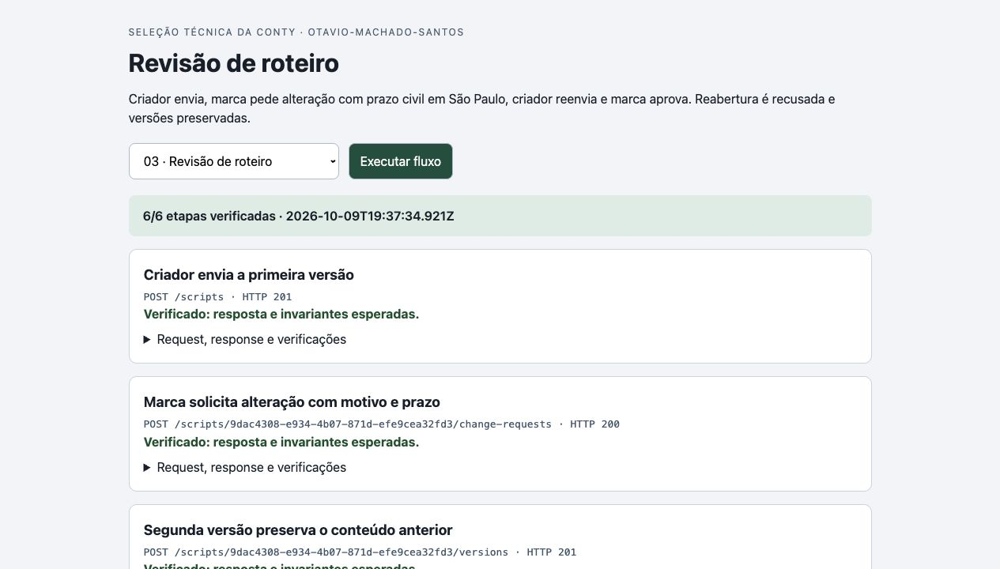
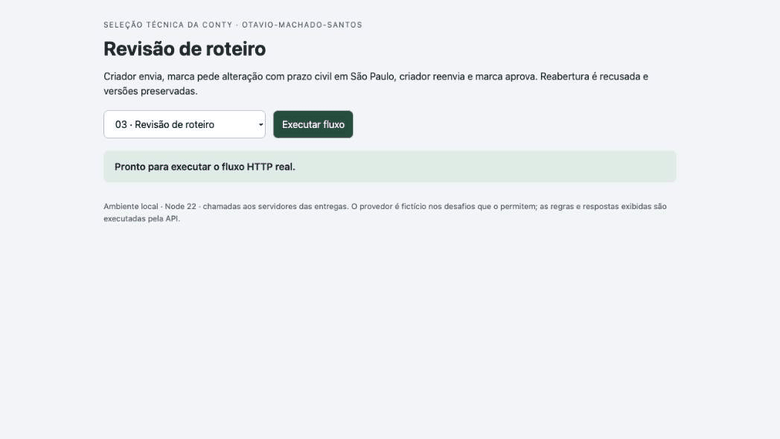

# Verificação final da entrega 3

Código revisado: `db12564279a7ab18d3c7e99759f24c69a6a78227`. Runtime: Node.js 22.23.3 em macOS.

Implementação e documentação: Codex. Revisão: dois agentes Codex independentes do implementador. Não houve revisão humana do código.

- 33 testes passaram no código final; [checkout isolado](evidence/coordenador-clone-limpo.txt).
- [Parecer A](reviews/03-a.json) e [parecer B](reviews/03-b.json), com sondagens independentes, limites e sugestões.
- [Transcrição HTTP real](evidence/coordenador-http.json): 21 etapas verificadas, com requests, respostas e invariantes.
- [Screenshot](evidence/screen.jpg), [resposta expandida](evidence/response.jpg) e [GIF da execução real](evidence/flow.gif).

O GIF foi codificado dos frames de screencast do navegador durante a execução das chamadas locais; não é uma montagem ou simulação. Os dados são fictícios. O portal apenas apresenta respostas da API e compara invariantes. Os limites de persistência, autenticação e operação estão no README. Os testes e capturas não representam deploy ou funcionamento em produção.

## Ajuste após a primeira revisão do Opus

O Opus pediu uma saída para um pedido de alteração vencido. A mesma marca agora pode renovar somente um pedido expirado da versão atual, mantendo o histórico. A resposta informa `change_request_status` como `active`, `expired` ou `null`, sem gravação durante a consulta. Pedido ainda ativo e aprovação encerrada continuam protegidos. Duas novas revisões Codex, 33 testes no checkout isolado e 21 etapas HTTP reais confirmaram a correção. A captura declara o relógio controlado: 18 chamadas atingem os handlers reais da API e 3 chamadas controlam uma fixture externa de relógio. A fixture pertence somente ao bootstrap de evidência, sem mudança nas rotas da API do produto.

A nota original registrada na Conty contém o caminho `src/review-service.js`; a entrada correta é [src/review.js](../src/review.js), também vinculada no README. O recibo original foi preservado. A reavaliação do ajuste pelo Opus foi concluída e está vinculada abaixo.

## Registro na Conty

Status observado: **Entrega registrada**, em 2026-10-09T19:43:52.671Z.

- [Link enviado](https://github.com/Otavio-Machado-Santos/conty-revisao-roteiro).
- [Página do desafio](https://challenge.appconty.com/desafios/revisao-roteiro).
- [Recibo e texto persistidos](evidence/conty-recibo.json).
- [Screenshot real do registro](evidence/conty-recibo.jpg).

O registro confirma o envio do link; a avaliação da Conty e o ranking dependem da auditoria da organização. Não é uma aprovação técnica pelo avaliador.

## Revisão adicional por Claude Opus 5.5

Após as nove entregas terem sido publicadas e registradas, Claude Code executou a validação solicitada com um subagente independente por desafio, usando `claude-opus-5-5`. Esta entrega recebeu **approved** sobre o código `db12564279a7ab18d3c7e99759f24c69a6a78227`.

- [Parecer, comandos, resultados, sugestões e limites](reviews/claude-opus55.json).
- [Prova do modelo e dos subagentes](reviews/claude-modelo.json).

Na primeira rodada, o Opus pediu um ajuste P2 nesta entrega. Codex corrigiu o comportamento, obteve duas novas revisões independentes, validou em checkout isolado, gravou novamente o fluxo HTTP e publicou a correção. O Opus reavaliou o commit novo e aprovou. O [parecer inicial com o pedido de ajuste](reviews/claude-primeira-rodada.json) foi preservado.

O modelo foi conferido nos eventos reais da CLI. O coordenador conferiu os hashes e consolidou o parecer final efetivamente emitido para cada commit; os arquivos de prova distinguem a rodada dos nove e as reavaliações. A revisão é assistida por IA, sem revisão humana; a avaliação oficial da Conty continua pendente.
